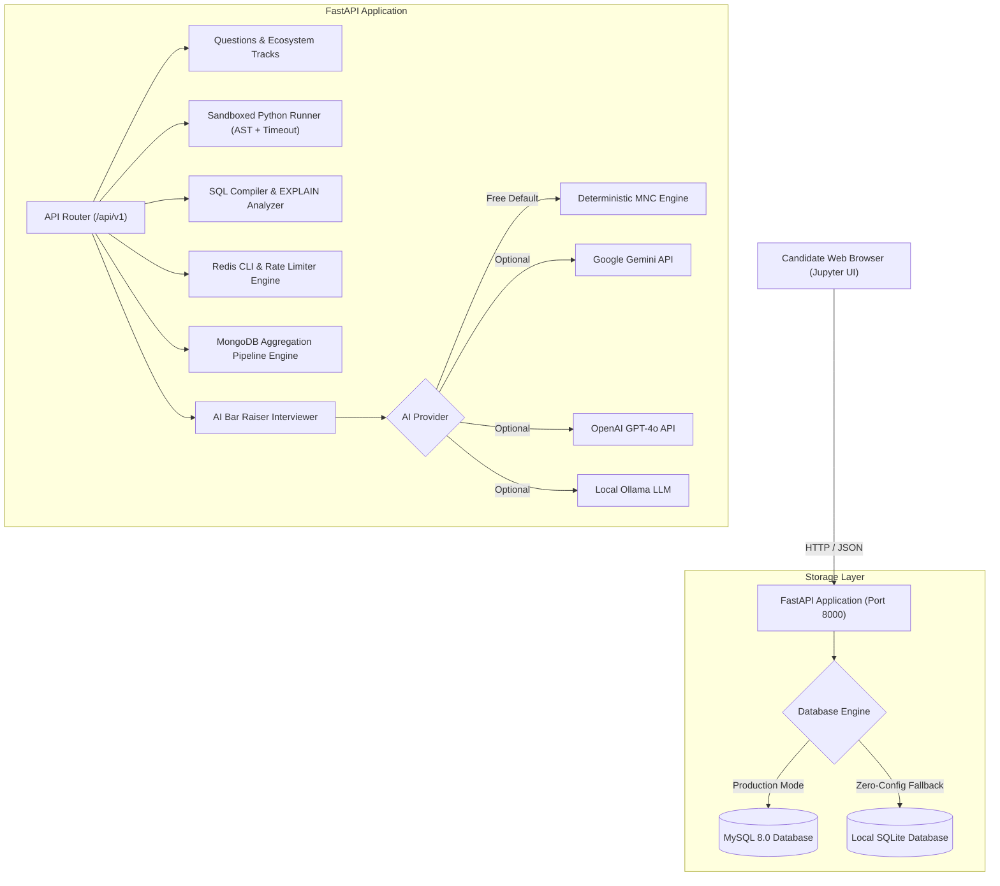

# ⚡ AI Python Backend & MNC Interview Trainer

[](https://fastapi.tiangolo.com)
[](https://www.python.org/)
[](https://www.postgresql.org/)
[](https://www.mysql.com/)
[](https://www.mongodb.com/)
[](https://redis.io/)
[](https://kafka.apache.org/)
[](https://docs.celeryq.dev/)
[](https://www.rabbitmq.com/)
[](https://www.docker.com/)
[](https://kubernetes.io/)
[](https://opensource.org/licenses/MIT)

> An open-source, interactive, Jupyter-style **AI Backend Interview Trainer** tailored for **MNC Technical Rounds** (Google, Amazon, Microsoft, Uber, Netflix, Stripe, Razorpay). 
> 
> Beyond basic syntax, it covers the **entire modern production backend engineering ecosystem**: **PostgreSQL, MySQL, MongoDB, Redis, Apache Kafka, Celery, RabbitMQ, Docker, Kubernetes, and CI/CD**. Features live **Python, SQL, Redis, and Mongo sandboxes**, **Theoretical Mind Maps**, and **Adaptive GenAI Bar Raiser Cross-Questioning** calibrated strictly to candidate years of experience.
> 
> **100% Free & Open-Source for Everyone to Prepare According to Their Experience Level!**

---

## 🎯 The Complete MNC Backend Ecosystem

Real MNC backend interviews evaluate your full production readiness across the stack:

| Domain | Key MNC Concepts Tested | Interactive Sandbox Available |
|---|---|:---:|
| 🐍 **Python & Asyncio** | GIL internals, Generational GC, memory leak profiling, event loop starvation, `asyncio.to_thread` vs `TaskGroup` | ✅ Sandboxed Python 3.12 Runner |
| 🐘 **PostgreSQL & MySQL** | MVCC, VACUUM table bloat, JSONB & GIN indexes, InnoDB B+ Trees, Next-Key deadlocks, `EXPLAIN` query plans | ✅ SQL Compiler + EXPLAIN Analyzer |
| 🍃 **MongoDB & NoSQL** | Document modeling, ESR indexing rule (Equality, Sort, Range), Aggregation pipelines, WiredTiger cache, replica sets | ✅ MongoDB Aggregation Runner |
| ⚡ **Redis & Caching** | Cache stampede mutex, sliding-window rate limiting with ZSET, Cache-Aside vs Write-Through, Redlock & Lua scripts | ✅ Redis In-Memory CLI Runner |
| 📨 **Apache Kafka** | Partition skew & hotspot keys, Cooperative Sticky rebalancing, manual offset commits, idempotent producers (`acks=all`) | ✅ Python Stream Simulator |
| 🌿 **Celery & RabbitMQ** | Worker concurrency (prefork vs gevent), task canvas (Chords/Chains), memory leaks (`max_tasks_per_child`), Dead-Letter Exchanges (DLX) | ✅ Task Retry & Canvas Simulator |
| 🐳 **Docker & Containers** | Multi-stage builds, non-root user hardening (`USER 1001`), layer caching order, Distroless images, SIGTERM handling | ✅ Multi-stage Template Analyzer |
| ☸️ **Kubernetes (K8s)** | Zero-downtime rolling updates (`preStop` sleep hook), Startup/Liveness/Readiness probe separation, HPA with KEDA, CPU CFS quota throttling | ✅ Graceful Shutdown Simulator |
| 🔄 **CI/CD & SRE** | GitHub Actions matrix, Trivy CVE security scanning, Canary rollouts (Argo Rollouts), Expand-and-Contract database migrations | ✅ Migration Pipeline Simulator |

---

## 🎓 Adaptive Experience Calibration

Select your experience level, and the entire platform (questions, depth of analysis, cross-question grilling, and rubrics) dynamically recalibrates:
- **🟢 Junior (0 - 2 YOE)**: Core Python internals, mutable default arguments, object reference equality, basic SQL joins & window functions (`DENSE_RANK()`), REST APIs, and Big-O complexities.
- **🟡 Mid-Level (3 - 5 YOE)**: Concurrency models (`asyncio` event loop blocking vs `to_thread`), Celery worker memory leaks, Redis cache stampedes, MongoDB aggregation pipelines, composite index leftmost prefix rule.
- **🟣 Senior (6 - 9 YOE)**: Flash-sale race conditions, atomic conditional SQL decrements, Kafka partition hotspotting & cooperative sticky rebalancing, Docker multi-stage hardening, Kubernetes zero-downtime rolling updates with `preStop` hooks.
- **🔴 Staff / Architect (10+ YOE)**: Dual-write problem (MySQL + Kafka consistency using Transactional Outbox Pattern + Debezium CDC), zero-downtime Blue-Green schema migrations (Expand-and-Contract pattern), multi-region active-active databases, and P99 incident troubleshooting.

---

## 🏗️ Architecture Overview



---

## 🚀 Quickstart Guide

### Option 1: Fast Local Setup (Zero-Config, Automatic Fallback)

Requires **Python 3.10+**. If MySQL is not running on your machine, the application will **automatically fall back to local SQLite** so you can start preparing immediately!

```bash
# 1. Clone repository
git clone -b dev https://github.com/vivekjais16/backend_interview_trainer_dev.git
cd backend_interview_trainer_dev

# 2. Create and activate virtual environment
python3 -m venv venv
source venv/bin/activate  # On Windows: venv\Scripts\activate

# 3. Install dependencies
pip install -r requirements.txt

# 4. Copy environment configuration
cp .env.example .env

# 5. Launch the application
python run.py
```

Open your browser at: **[http://localhost:8000](http://localhost:8000)**

Interactive API Swagger documentation is at: **[http://localhost:8000/docs](http://localhost:8000/docs)**

---

### Option 2: Full Docker & MySQL 8 Setup (Recommended for Production)

Run the full stack with dedicated MySQL 8.0 container using Docker Compose:

```bash
# Build and run containers
docker-compose up --build -d

# View logs
docker-compose logs -f
```

---

## 📡 REST API Reference

| Method | Endpoint | Description |
|---|---|---|
| `GET` | `/` | Interactive Jupyter-style Web UI |
| `GET` | `/api/v1/questions` | List interview questions with experience level & domain category filters |
| `GET` | `/api/v1/questions/{id_or_slug}` | Get question detail, scenarios, starter code & cross questions |
| `POST` | `/api/v1/sandbox/python` | Run sandboxed Python code with execution duration & output |
| `POST` | `/api/v1/sandbox/sql` | Execute SQL query with `EXPLAIN` query plan analysis |
| `POST` | `/api/v1/sandbox/redis` | Run in-memory Redis CLI commands (Strings, Hashes, ZSETs) |
| `POST` | `/api/v1/sandbox/nosql` | Execute MongoDB-style find and aggregation pipelines |
| `GET` | `/api/v1/sandbox/sql/schemas` | Get metadata for E-Commerce, FinTech, and HR schemas |
| `POST` | `/api/v1/interview/sessions` | Initialize a new MNC mock interview session |
| `POST` | `/api/v1/interview/turns` | Submit answer/code for AI Bar Raiser evaluation & cross-questions |
| `GET` | `/api/v1/interview/sessions/{id}` | Retrieve complete interview turn history and score |
| `GET` | `/api/v1/mindmaps` | Get all theoretical mindmap roadmaps and Mermaid diagrams |
| `GET` | `/api/v1/mindmaps/{slug}` | Get specific mindmap topic with deep concept breakdowns |
| `GET` | `/api/v1/analytics/stats` | System health check, database status, and ecosystem domains |

---

## 🧪 Running Automated Tests

The test suite validates the Python AST sandbox, SQL compiler, Redis CLI, MongoDB aggregation engine, schemas, and API routers:

```bash
# Run pytest with detailed verbose output
pytest -v
```

---

## 🌿 Git Branch & Repository

- **Repository**: [https://github.com/vivekjais16/backend_interview_trainer_dev.git](https://github.com/vivekjais16/backend_interview_trainer_dev.git)
- **Active Branch**: `dev`

To push changes to your GitHub branch:
```bash
git add .
git commit -m "feat: complete MNC interview trainer with Postgres, Mongo, Redis, Kafka, Celery, Docker, K8s, CI/CD"
git push -u origin dev
```

---

## 🤝 Contributing

We welcome contributions from engineers across all experience levels!
1. Fork the Project.
2. Create your Feature Branch (`git checkout -b feature/NewMNCQuestion`).
3. Commit your Changes (`git commit -m 'feat: add Kafka partition rebalancing scenario'`).
4. Push to the Branch (`git push origin feature/NewMNCQuestion`).
5. Open a Pull Request.

---

## 📄 License

Distributed under the MIT License. See `LICENSE` for more information.
